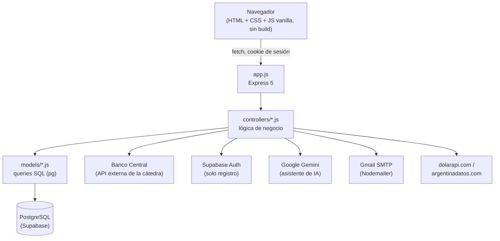

# Arquitectura

## Visión general

Aplicación monolítica Node.js/Express clásica (sin frameworks de frontend, sin build step): el servidor sirve tanto la API JSON como los archivos HTML/CSS/JS estáticos del frontend. No hay separación cliente/servidor en repos distintos ni un SPA — cada pantalla es un archivo `.html` independiente con su propio `<script>` inline.



## Capas

- **`app.js`**: único entry point. Registra todas las rutas, el middleware de CORS/cookies/JSON, el modo mantenimiento, y corre las migraciones `CREATE TABLE IF NOT EXISTS` al arrancar.
- **`controllers/`**: un archivo por dominio (`personaController`, `prestamoController`, `reservaController`, `tarjetaController`, `qrController`, `notificacionController`, `asistenteController`, `cronController`). Validan el input, aplican las reglas de negocio, llaman a los models y a APIs externas.
- **`models/`**: queries SQL planas (no hay ORM). Cada archivo es un objeto con funciones async que usan el pool de `config/db.js` directo con `pg`.
- **`utils/`**: helpers compartidos sin estado de negocio propio — `sesion.js` (JWT), `mailer.js` (emails), `moverSaldo.js` (updates atómicos de saldo), `fetchConTimeout.js` (fetch con `AbortController`), `qrJwt.js` (firma/verifica QR), `notificaciones.js`, `centralDeudores.js`, `tasaTarjeta.js`.
- **`public/`**: 15 páginas HTML autocontenidas, servidas como estáticos por Express. Comparten `tuo-i18n.js` (traducción ES/EN, formato de moneda, tema claro/oscuro, helpers de XSS).
- **`config/db.js`**: pool único de conexión a Postgres, reusado por todos los models.
- **`init/`**: esquema SQL base (`01_schema.sql`) y datos de ejemplo (`02_data.sql`) para levantar la base desde cero.

## Por qué no hay un ORM ni un framework de frontend

Decisión del proyecto desde el inicio: todo el stack es deliberadamente simple (Node + Express + `pg` crudo, HTML/CSS/JS sin build). Esto significa que agregar una feature nueva casi siempre implica tocar 3 archivos por dominio (`model` + `controller` + la ruta en `app.js`) más la página HTML correspondiente, siguiendo el mismo patrón que ya existe para Préstamos/Reservas/Tarjetas.

## Estructura de carpetas

```
LBZ-PP1_banco-main/
├── app.js                   # Entry point: rutas, middleware, migraciones al arrancar
├── package.json
├── vercel.json               # Config de despliegue (incluye el cron diario de préstamos)
├── .env                       # Variables de entorno (no se commitea)
│
├── config/
│   └── db.js                  # Pool de conexión PostgreSQL
│
├── controllers/                # Un archivo por dominio — ver funcionalidades.md
├── models/                     # Queries SQL por dominio
├── utils/                      # Helpers compartidos (sesión, mail, QR, etc.)
│
├── init/
│   ├── 01_schema.sql           # Esquema base
│   └── 02_data.sql             # Datos de ejemplo (3 personas de prueba)
│
├── docs/                       # Esta documentación
│
└── public/                     # Frontend — 15 páginas HTML + tuo-i18n.js compartido
```

## Cómo fluye una request típica (ejemplo: transferir dinero)

```mermaid
sequenceDiagram
    participant U as Usuario (navegador)
    participant E as Express (app.js)
    participant RA as requireAuth
    participant C as personaController.transferir
    participant M as personaModel
    participant BC as Banco Central
    participant DB as PostgreSQL

    U->>E: POST /api/transferencia {cbuOrigen, cbuDestino, importe}
    E->>RA: valida cookie tuo_session
    RA->>C: req.idPersona = 42
    C->>M: getByCbu(cbuOrigen)
    M->>DB: SELECT cuenta + dueño
    DB-->>M: fila
    M-->>C: cuenta origen
    C->>C: ¿cuentaOrigen.id_persona === req.idPersona? ¿misma moneda que destino? ¿saldo suficiente?
    C->>BC: POST /transactions
    BC-->>C: {estado: "aprobada", _id}
    C->>M: debitarYAcreditar(origen, destino, importe)
    M->>DB: BEGIN; SELECT...FOR UPDATE; UPDATE saldo; COMMIT
    DB-->>M: nuevoSaldo
    M-->>C: nuevoSaldo
    C-->>U: 201 {nuevoSaldo, transaccionId}
```

Ver [funcionalidades.md](funcionalidades.md) para el flujo completo de cada feature y [seguridad.md](seguridad.md) para el detalle de cada chequeo.
