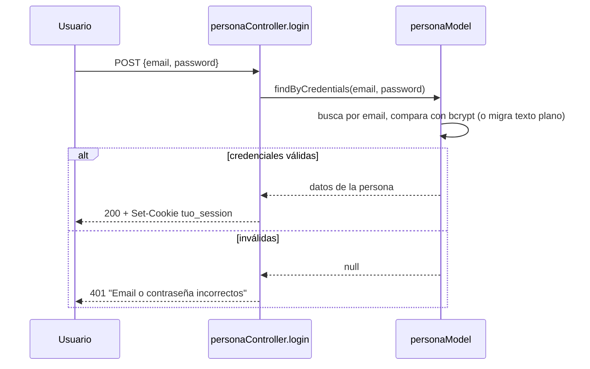

# Funcionalidades

Cada sección cubre una funcionalidad real del código: qué hace, quién la usa, el flujo paso a paso, validaciones y errores posibles. Rutas exactas en [api.md](api.md).

## Registro y verificación de cuenta

El servidor (no el navegador) da de alta la persona en el Banco Central para conseguir el CBU real — esto evita que alguien registre una cuenta con un CBU inventado.

1. El usuario completa nombre, apellido, DNI, email, teléfono, fecha de nacimiento, domicilio y contraseña (mínimo 8 caracteres, validado también en el servidor).
2. El servidor llama al Banco Central (`POST /persons`) con nombre/apellido/DNI. Si el DNI ya existe ahí, devuelve `409`.
3. Con el CBU y alias que devuelve el Banco Central (o un alias generado localmente si no viene ninguno), crea el usuario en Supabase Auth y la fila en `Personas` + `Productos` + `Cuentas_Bancarias`, todo en una transacción — si algo falla a mitad de camino, borra el usuario de Supabase Auth para no dejar huérfanos.
4. Manda un código de 6 dígitos por email (Nodemailer/Gmail). La cuenta queda `verificado = FALSE` hasta confirmarlo.

**Errores**: campos faltantes (`400`, lista cuáles), contraseña corta (`400`), DNI duplicado (`409`), Banco Central caído o lento (`502`/`504`).

## Login / logout

Email + contraseña, verificados contra el hash bcrypt. Si la cuenta todavía tiene la contraseña en texto plano (cuentas viejas), se compara igual y se re-hashea en el momento. Devuelve una cookie de sesión httpOnly. Ver [seguridad.md](seguridad.md) para el detalle del JWT.

## Transferencias y depósitos

Transferir exige que la cuenta de origen sea propia, que haya saldo suficiente, y que origen y destino tengan la misma moneda. La transacción se manda primero al Banco Central (que la aprueba/rechaza) y solo si aprueba se mueve el saldo local, de forma atómica. Depositar es más simple: acredita directo en una cuenta propia, con un tope de $1.000.000 por operación.

## Cuenta en dólares

Abrir la cuenta USD exige re-confirmar DNI/teléfono/email (deben coincidir con los ya registrados) y un código de verificación — como un segundo factor liviano para una operación sensible. Una vez abierta, se puede comprar/vender USD contra ARS a la cotización MEP (`cambiarDivisa`), y transferir en USD igual que en ARS.

## Préstamos personales

1. **Perfil crediticio** (`GET /api/prestamos/perfil-crediticio`): un puntaje 0-100 basado en ingreso promedio de los últimos 6 meses (propios movimientos) y puntualidad de pago en préstamos anteriores, que determina un `montoMaximo` disponible.
2. **Simular** (sin pedir nada): dado un monto y plazo, muestra la cuota (sistema francés) y el total a pagar, usando la TNA de referencia real (promedio del BCRA vía api.argentinadatos.com).
3. **Solicitar**: re-evalúa el perfil en el servidor (nunca confía en lo que calculó el cliente) y, si aprueba, acredita el monto en la cuenta ARS y genera el cronograma de cuotas.
4. **Pagar una cuota** puntual, o **cancelar anticipado** (cobra solo el capital pendiente, sin intereses futuros).
5. Un cron diario (`GET /api/cron/prestamos-diario`, protegido con `CRON_SECRET`) manda recordatorios de cuotas por vencer y reporta la situación a la Central de Deudores simulada.

## Reservas (plazo fijo y "frasco")

Tres modalidades: `FIJO_MESES` y `FIJO_DIAS` (capital bloqueado hasta el vencimiento, con una tasa fija conocida de antemano) y `FRASCO` (depositás y retirás cuando quieras, tasa más baja). No hay cron: cada vez que se consulta `GET /api/reservas`, el propio código liquida cualquier plazo fijo ya vencido y devenga el interés pendiente del frasco, con el mismo patrón de lock que usa el resto de las operaciones de dinero.

## Tarjetas de débito y crédito

- **Débito**: vinculada 1 a 1 a la caja de ahorro en ARS. Comprar debita el saldo en el momento.
- **Crédito**: límite fijo al emitir, compras en 1/3/6/12 cuotas (financiadas a la TNA real de tarjetas), resumen con pago mínimo, intereses sobre el saldo financiado si no se paga todo.
- Bloquear/desbloquear cambia el estado del producto; una tarjeta bloqueada rechaza compras pero el resumen se puede seguir pagando.
- El número completo y el CVV solo se ven una vez, al emitir la tarjeta — ver [seguridad.md](seguridad.md).

## QR de cobro (propio e interbancario)

Generar un QR firma un JWT (ES256) con el CBU propio (y un monto opcional). Al escanearlo, cualquier banco de la cátedra puede verificar la firma: si es de "tuo" y la firma es válida, el pago se aprueba; si es de otro banco conocido, también se verifica su firma; si no se reconoce al emisor, se decodifica igual pero sin garantía (`tipo:"no_verificado"`). El QR puede marcarse de un solo uso (`jti`), y el dueño recibe una notificación cuando alguien lo escanea.

## Notificaciones in-app

Se generan del lado del servidor ante eventos reales: transferencia recibida, depósito, préstamo otorgado/vencido/cancelado, cuota por vencer, tarjeta emitida/usada, cambio de contraseña, nuevo dispositivo detectado al loguear. El frontend hace polling liviano cada 30s para el contador de no leídas.

## Asistente de IA

Chat con Google Gemini que puede *de verdad* consultar tus propios datos (saldo, movimientos, préstamos activos, perfil crediticio, cotización del dólar) a través de tool-use — nunca mueve dinero ni accede a datos de otra cuenta, porque cada tool se ejecuta con el `idPersona` de la sesión, nunca con uno que mande el modelo. Tope de 30 mensajes por persona por día (cuota gratuita compartida).

## Qué NO existe todavía (del roadmap original, descartado o pendiente)

- **Inversiones (CEDEARs)**: descartado, no se va a construir.
- **Recarga de celulares, pago de servicios, seguros**: descartados.
- **PWA (app instalable)**: pendiente, sin alcance definido.
