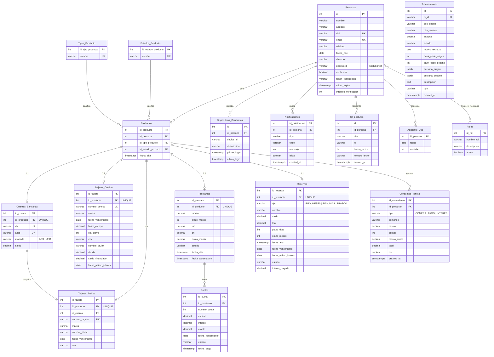

# Modelo de datos

Base PostgreSQL (hosteada en Supabase). El esquema base vive en [`init/01_schema.sql`](../init/01_schema.sql); el resto de las tablas se crean en runtime la primera vez que arranca el servidor, con `CREATE TABLE IF NOT EXISTS` directo en [`app.js`](../app.js) — no hay un sistema de migraciones versionado, cada tabla nueva se agregó como un bloque de SQL idempotente.

## Diagrama entidad-relación

## Notas sobre el diseño

- **`Productos` es la tabla central**: cada producto bancario de una persona (caja de ahorro, tarjeta, préstamo, reserva) es primero una fila en `Productos` con un tipo (`Tipos_Producto`) y un estado (`Estados_Producto`), y recién después la tabla específica (`Cuentas_Bancarias`, `Tarjetas_Credito`, etc.) se cuelga de ese `id_producto` en una relación 1 a 1. Esto permite bloquear/cerrar cualquier producto cambiando solo `Estados_Producto`, sin tocar la tabla específica.
- **`Transacciones` es un historial unificado**, no una tabla por tipo de movimiento. Un mismo movimiento de dinero (transferencia, depósito, préstamo, tarjeta, cambio de divisa, reserva) cae ahí con un `tipo` distinto y, en los casos donde no hay una cuenta bancaria real de origen/destino, un **sentinel** en `cbu_origen`/`cbu_destino` (`'DEPOSITO'`, `'PRESTAMO'`, `'RESERVA'`, `'TARJETA'`). *A confirmar: estos sentinels no están documentados como constantes en un solo lugar — aparecen repetidos literal en cada controller.*
- **`Cuotas.capital`/`Cuotas.interes` se guardan por separado** (no solo el total) específicamente para poder calcular el capital pendiente real al momento de una cancelación anticipada de préstamo, sin cobrar intereses futuros no devengados.
- **El CVV de tarjetas se persiste** (`Tarjetas_Credito.cvv`, `Tarjetas_Debito.cvv`) pero el backend nunca lo devuelve salvo en la respuesta de alta (`POST /api/tarjetas/emitir`) — ver [seguridad.md](seguridad.md).
- No hay `ON DELETE CASCADE` en la mayoría de las foreign keys nuevas (sí en `Roles_x_Personas`), así que borrar una fila de `Personas` a mano requiere borrar antes, en orden, sus filas en `Productos` y todas las tablas hijas — no hay una ruta de la API que borre una persona.
